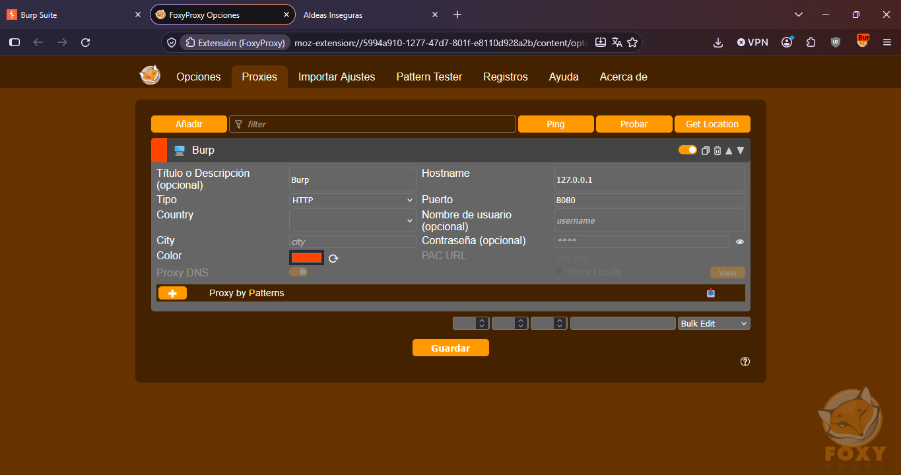
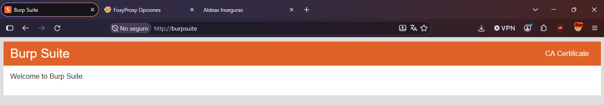
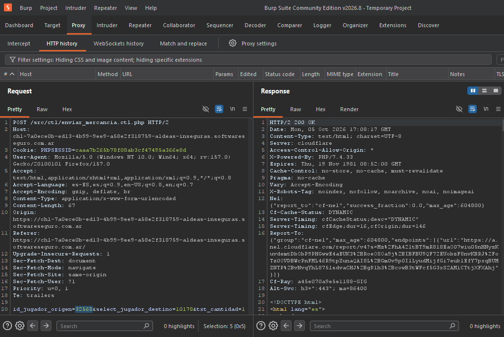

## Análisis de Peticiones Interceptadas

Tras incluir la extension de FoxyProxy, vincularla con el puerto otorgado por el burpsuite y luego descargar el certificado, logré interceptar un lab de Software Seguro, más especificamente el de Aldeas Inseguras. 

### Petición 

* **Endpoint:** `/src/ctl/enviar_mercancia.ctl.php` 
* **Método HTTP:** `POST` 
* **Explicación:** En este endpoint, nosotros realizamos una transferencia de oro entre las aldeas, de modo que en el body indicamos los id de las aldeas involucradas (quien envia y quien recibe) y el monto de oro a transferir. 