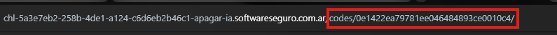
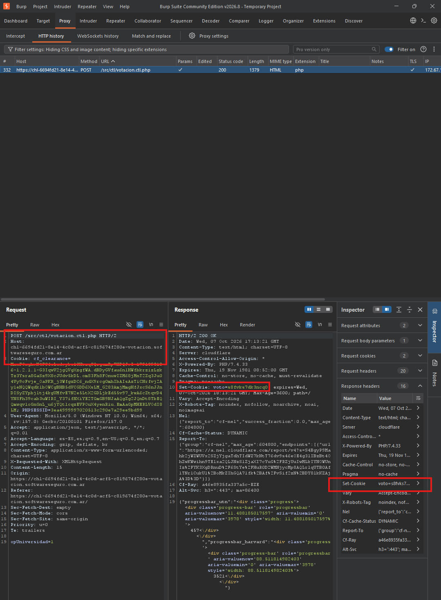

## Ejecucion de laboratorios
### Apagar la IA
Para este ejercicio que trata la vulne de IDOR, opte por iterar en el parametro de la URL ``codes/numero/``, con el objetivo de obtener un rango en el cual estaban estas claves que necesitabamos.

 Una vez obtenido dicho rango (entre los 9000 y los 12000 todo hasheado por supuesto), con un script fui iterando en cada una de estas en la busqueda de un elemento listado bajo la etiqueta ``<li>`` de manera que tenga una longitud de 16 caracteres. Una vez obtenida dicha contraseña, basto con hashearla y asi obtener la flag. 

### El mejor secreto
Tras analizar el video, busque un cierto patron o expresion regular que se pueda cumplir para poder acotar la cantidad de intentos de este ataque de fuerza bruta.
Con esto obtuve un listado de contraseñas posibles/candidatas. Con ellas formule un script para que pruebe cada una de ellas con el comprimido, de manera que cuando lo logre me informe con cual de ellas fue. Con esta, extraje el archivo txt obteniendo asi la flag.

### Votacion 
Para este lab de Broken Access Control,en una primera instancia intercepte la peticion de votacion. En esta, se puede observar el seteo de una cookie, cookie que luego nos impide votar nuevamente. Sin embargo, si enviamos esta primer peticion multiples veces, al no tener asociada ninguna cookie, nosotros podemos formular multiples votos. Llegando asi al objetivo. 
 

Para la nueva version, podemos observar una restriccion al estilo "rate limit" en donde nos bloqueaban por ip. Por ello opté por incluir en su cabecera le ``X-Forwarded-For`` y asi con un intruder enviar la misma solicitud mediante multiples ips. 
