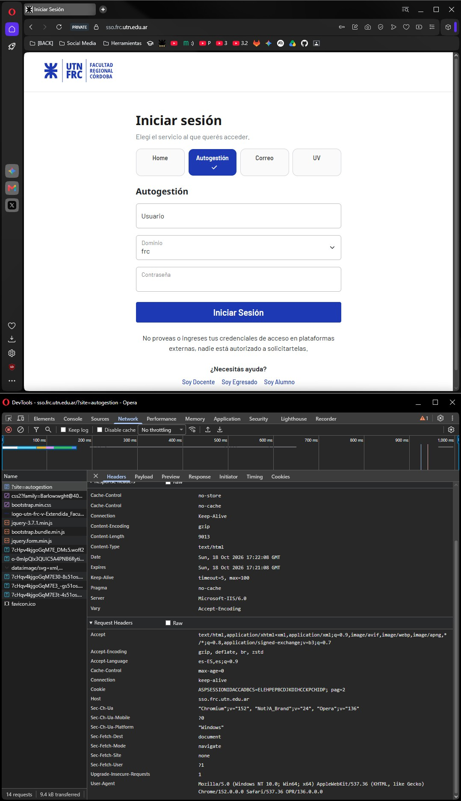
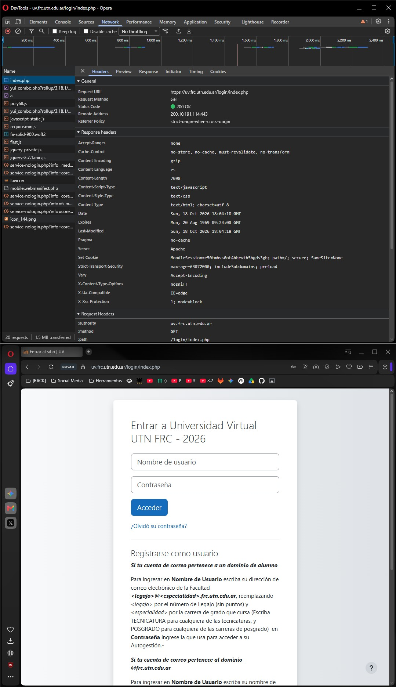
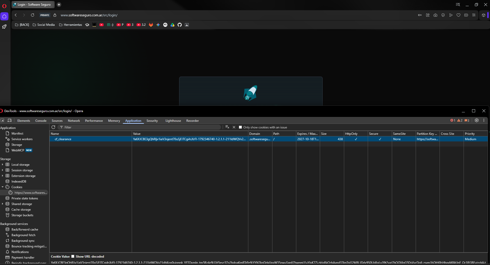

# Objetivo 1: Auditoría de Cookies y Banderas de Seguridad

## 1. Preguntas Teóricas

### Bandera `HttpOnly`
La bandera `HttpOnly` previene que las cookies sean leídas, modificadas o filtradas mediante scripts del lado del cliente ejecutados en el navegador (específicamente a través de la propiedad `document.cookie` de JavaScript).

### Bandera `Secure`
La bandera `Secure` instruye al navegador a transmitir la cookie **únicamente a través de canales cifrados mediante HTTPS / TLS**, restringiendo su envío a través de HTTP sin cifrar. Si la bandera `Secure` está ausente, el navegador enviará automáticamente la cookie en texto "claro" ante cualquier solicitud HTTP . Esto en redes Wi-Fi abiertas o compartidas (campus universitario, cafeterías, etc), un atacante puede capturar los paquetes de red mediante herramientas pasivas de captura (*sniffing*) y obtener el identificador de sesión en texto plano, logrando el "secuestro" sin necesidad de vulnerar la contraseña de la víctima.

---

## 2. Auditoría Pasiva en Tres Sitios de Uso Cotidiano

| Sitio Web Analizado | Mecanismo de Sesión / Parámetro | Bandera `Secure` | Bandera `HttpOnly` | Atributo `SameSite` |
| :--- | :---: | :---: | :---: | :---: | 
| **1. UTN FRC (SSO / Autogestión)** `https://sso.frc.utn.edu.ar/` | Cookie: `ASPSESSIONIDACCADBCS` |  **Ausente** |  **Ausente** |  **Ausente** | **Vulnerable (Severidad Alta):** Fuga de sesión en texto claro por red y exposición directa a robo por JavaScript/XSS. |
| **2. Campus Virtual UTN FRC (UV)** `https://uv.frc.utn.edu.ar/login/index.php` | Cookie: `MoodleSession` |  **Presente** |  **Ausente** |  **Ausente** | **Parcial / Insegura frente a XSS:** Protegida contra intercepción en red gracias a `Secure` y HSTS, pero la falta de `HttpOnly` permite que JavaScript lea la sesión. |
| **3. Software Seguro (Plataforma)** `https://www.softwareseguro.com.ar` | Web Storage: `localStorage.getItem("auth")` |  **N/A** (No usa Cookie) |  **Inexistente** (No aplicable a Storage) |  **N/A** | **Riesgo Arquitectónico (ASVS V3.4.2):** Almacena el token de sesión en `localStorage` en lugar de cookies con `HttpOnly`, exponiendo el token a lectura total ante XSS. |

---

## 3. Evidencias de Intercepción de Cookies en Inspector de Red

### 1. UTN FRC (SSO / Autogestión)
Intercepción de la cookie de sesión `ASPSESSIONIDACCADBCS` en el portal SSO, evidenciando la omisión total de las banderas `Secure` y `HttpOnly`:

---

### 2. Campus Virtual UTN FRC (UV Moodle)
Intercepción de la cookie de sesión `MoodleSession` en el formulario de acceso de la UV, evidenciando la presencia de `Secure` pero la **ausencia de `HttpOnly`**:

---

### 3. Software Seguro (Plataforma)
Inspección del mecanismo de sesión en el portal de Software Seguro, evidenciando la gestión de tokens de sesión mediante `localStorage` / ausencia de cookies con bandera `HttpOnly`:

